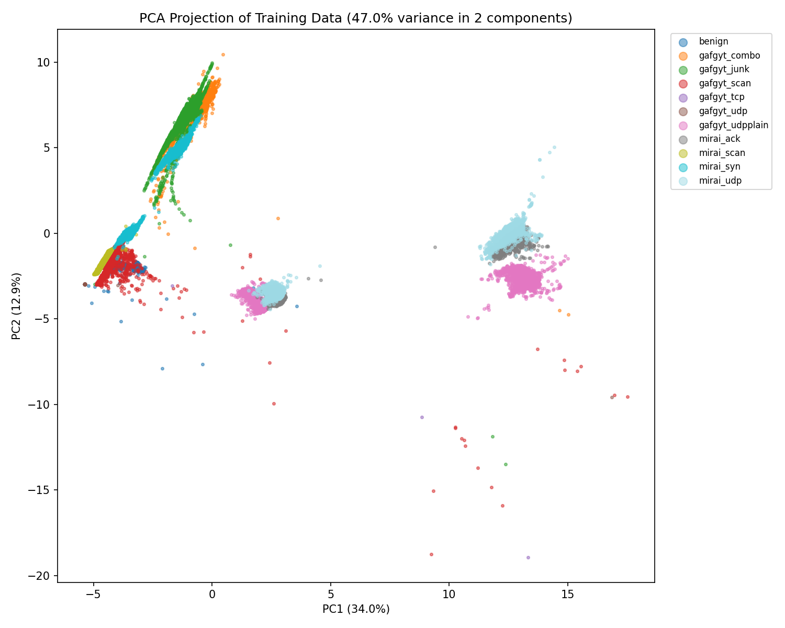

# IoT Botnet Intrusion Detection: a From-Scratch Random Forest on N-BaIoT

Classifies network traffic of an IoT device (a Danmini doorbell) as **benign** or one of **10 Mirai / Gafgyt (BASHLITE) attack types**,
using the 115 statistical traffic features of the [N-BaIoT](https://archive.ics.uci.edu/dataset/442/detection+of+iot+botnet+attacks+n+baiot) dataset.

**Every learning component is implemented from scratch with numpy, with no scikit-learn or other ML library:** stratified splitting and scaling,
a CART decision tree, a Random Forest, PCA, and all metrics (confusion matrix, precision/recall/F1, ROC/AUC). The project also re-implements N-BaIoT's
streaming feature extractor so that live traffic can be classified on a Raspberry Pi Zero 2 W.

*7th-semester Machine Learning Project-Based Learning (PBL), Pandit Deendayal Energy University.*

## Results

| Evaluation | Test accuracy |
|---|---|
| Random stratified split (64 / 16 / 20) | **99.90%** (macro-F1 about 0.999; 11 errors in 11,000 rows) |
| Time-ordered split (train on the first 65% of each capture, test on the last 30%) | **82.27%** (family-level benign / Mirai / Gafgyt accuracy 99.98%) |
| Interleaved blocks (train on blocks 0,2,4,6,8 of each capture, test on 1,3,5,7,9) | **96.14%** (macro-F1 0.961) |

The gaps are the main finding. The features are decayed running statistics, so neighbouring rows are near-duplicates and a random split leaks information into the test set.
The interleaved-block evaluation (same stretches of each capture for training and testing, edges dropped) separates two causes. `gafgyt_udp` and `gafgyt_tcp` are almost perfectly separable in that setting
(recall 1.000 and 0.999) but collapse in the time-ordered split, so their failure is **drift between early and late traffic**. `gafgyt_junk` and `gafgyt_combo` stay confused even in-capture (recall 0.72 and 0.86),
so they genuinely overlap; the dataset gives no obvious reason, and we make no claim about the cause. Benign traffic, the Mirai types and the attack *family* are easy in every setting.
Details, tables and the overfitting/underfitting analysis are in the report and in `results/`.



## Repository structure

```
botnet-intrusion/
├── README.md
├── requirements.txt            # offline pipeline + notebook (numpy, pandas, matplotlib, jupyter)
├── requirements-live.txt       # Raspberry Pi live detection (numpy, scapy)
├── notebooks/
│   └── PBL_ML_Pipeline.ipynb   # the complete ML code in one notebook
├── src/
│   ├── load_data.py            # load + label the 11 CSV files
│   ├── split_and_scale.py      # stratified train/val/test split, train-only z-score scaling
│   ├── decision_tree.py        # from-scratch CART tree (Gini, vectorised split search)
│   ├── random_forest.py        # from-scratch Random Forest (bagging + feature subsampling)
│   ├── pca.py                  # from-scratch PCA
│   ├── evaluate.py             # final model + confusion matrix, P/R/F1, ROC/AUC
│   ├── visualize.py            # class distribution, correlation heatmap, PCA scatter, scree plot
│   ├── overfitting_sweep.py    # depth / forest-size sweeps (train vs validation)
│   ├── time_split_eval.py      # time-ordered evaluation
│   ├── block_cv_eval.py        # interleaved-block diagnosis of the time-split drop
│   ├── afterimage.py           # damped incremental statistics engine (streaming)
│   ├── extractor.py            # streaming 115-feature extractor (N-BaIoT column order)
│   ├── validate_extractor.py   # numerical validation of the extractor vs the authors' code
│   ├── packet_features.py      # scapy packet -> extractor input (fallback engine)
│   ├── fastcapture.py          # dependency-free capture + header parser (~230x faster than scapy)
│   ├── validate_capture.py     # fast parser vs scapy: equivalence, edge cases, live loopback, speed
│   ├── traffic_sim.py          # rate-limited, private-network-only traffic generator (+ label markers)
│   ├── demo_replay.py          # fallback: laptop rehearsal of the live demo with synthetic traffic
│   ├── demo_nbaiot.py          # fallback: real N-BaIoT rows through the real model on the dashboard (numpy only)
│   ├── demo_loopback.py        # fallback: live capture + full pipeline on one Linux/WSL machine
│   ├── build_demo_bundle.py    # builds demo_data/ from the full dataset (run once)
│   ├── led_indicator.py        # traffic-light LEDs driven by the dashboard API (--simulate without hardware)
│   ├── benchmark.py            # packets/s of parser + extractor + forest: run it on the Pi
│   ├── dashboard.py            # stdlib web-dashboard server (status page for the live detector)
│   ├── dashboard_static/
│   │   └── index.html          # the dashboard page (self-contained, no CDN, works offline)
│   ├── model_io.py             # export / load a numpy-only forest for the Pi
│   ├── live_detector.py        # live or pcap-replay: `collect` and `detect` commands
│   ├── train_live_model.py     # train + export a model from your own captured traffic
│   └── make_test_pcaps.py      # synthetic traffic for testing without hardware
├── demo_data/                  # small bundle (2 models + 2 replay streams) for demo_nbaiot.py
├── tests/
│   └── dashboard_page_test.js  # jsdom test of the dashboard page (needs node)
├── scripts/
│   ├── run_pipeline.sh         # runs the whole offline pipeline
│   ├── fetch_reference.sh      # downloads the authors' reference code (validation only)
│   └── pi/                     # setup_pi.sh (first boot) + systemd units for the Pi (detector + LEDs)
├── results/                    # metrics and sweep tables (CSV) from the full run
├── figures/                    # dataset figures
├── docs/                       # PI_SETUP.md runbook, DEMO_OPTIONS.md fallback ladder; report, slides, photos go here
└── data/
    └── README.md               # how to obtain the dataset (data itself is not committed)
```

## Quick start

```bash
git clone https://github.com/LeoTheEmperor/botnet-intrusion.git
cd botnet-intrusion
python -m venv .venv && source .venv/bin/activate      # Windows: .venv\Scripts\activate
pip install -r requirements.txt
```

1. **Get the data** (about 1 GB, not in the repo): follow [`data/README.md`](data/README.md) and put the 11 Danmini CSVs in `data/raw/`.
2. **Run everything** (about 10 minutes): `bash scripts/run_pipeline.sh` (set `PYTHON=python3` if needed), or run the steps one by one:
   `python src/load_data.py`, then `split_and_scale.py`, `evaluate.py`, `visualize.py`, `overfitting_sweep.py`, `time_split_eval.py`.
3. **Or use the notebook:** `jupyter lab notebooks/PBL_ML_Pipeline.ipynb`. Setting the environment variable `PBL_FAST=1` runs a small, quick version for a smoke test.

## Live detection pipeline

Packets -> streaming 115-feature extractor -> scaler -> forest -> label per time window, shown on the console, in a **web dashboard**, and optionally in a JSON status file (for LEDs).

```bash
pip install -r requirements-live.txt     # numpy only; scapy is optional

# easiest: one command rehearses everything (synthetic traffic, trains, replays with the dashboard)
python src/demo_replay.py          # needs numpy + scapy; opens http://localhost:8080

# or step by step, without any hardware, using synthetic traffic
python src/make_test_pcaps.py --out pcaps/train --seed 1
python src/live_detector.py collect --pcap pcaps/train/mixed.pcap --out data/live/session1.csv \
       --schedule "benign:6,syn_flood:6,benign:6,udp_flood:6,benign:6,port_scan:6,benign:6"
python src/train_live_model.py --data data/live --out models/live_model.npz --final
python src/live_detector.py detect --pcap pcaps/train/mixed.pcap --model models/live_model.npz

# the same with the live web dashboard (open http://localhost:8080); --realtime replays at the recorded speed
python src/live_detector.py detect --pcap pcaps/train/mixed.pcap --model models/live_model.npz --dashboard 8080 --realtime

# on the Raspberry Pi (needs sudo; use only on a network you own)
sudo python3 src/live_detector.py collect --iface wlan0 --schedule "benign:120,syn_flood:30,benign:60" --out data/live/s1.csv
sudo python3 src/live_detector.py detect  --iface wlan0 --model models/live_model.npz \
     --dashboard 8080 --dashboard-host 0.0.0.0     # then open http://<pi-address>:8080 from your laptop or phone
```

**Dashboard.** One page, no internet needed: a large NORMAL / SUSPICIOUS / ALERT status card, packets per second, a timeline of the last 180 windows coloured by predicted class
(hover for details), traffic totals per class, and an alert log. It is read-only and unauthenticated, so it binds to `127.0.0.1` unless you pass `--dashboard-host 0.0.0.0`; do that only on a network you own.
In live mode the detector automatically ignores the dashboard's own HTTP traffic so it does not pollute the classifier's input.

**Packet engines.** The default `fast` engine (`src/fastcapture.py`, standard library only) reads a raw Linux socket or a classic pcap and parses just the needed headers:
about 5 microseconds per packet, versus about 1,000 for scapy, which would otherwise be the bottleneck before the machine learning is. It handles Ethernet (+ one VLAN tag), IPv4, IPv6 without extension headers,
TCP, UDP, ICMP and ARP. Use `--engine scapy` for pcapng files, BPF filters or non-Linux live capture.

Record training data as **continuous sessions labelled by time segment** (`--schedule`), not one file per class: the long-window features remember history,
and cold-start captures taught a model that missed a port scan which followed earlier floods. Synthetic traffic is far easier to separate than real traffic,
so it only shows that the pipeline works.

## Tests

- `bash scripts/fetch_reference.sh && python src/validate_extractor.py`: extractor vs the authors' implementation (max relative deviation about 9e-13 over 4,000 packets x 115 features).
- `python src/validate_capture.py`: fast packet parser vs scapy (identical on 22,198 packets and 10 hand-crafted edge cases), live raw-socket capture on loopback, speed.
- `node tests/dashboard_page_test.js`: renders the dashboard page in jsdom against a running detector (see the file header for the exact commands).

## Demo on a Raspberry Pi Zero 2 W

The full runbook is in [`docs/PI_SETUP.md`](docs/PI_SETUP.md): flashing and headless Wi-Fi, a benchmark to run first, recording training data, training on the laptop, running the detector with the dashboard and
LEDs, wiring, auto-start, a fallback replay, troubleshooting and a demo-day checklist. In short:

1. **Record** continuous sessions on the Pi (`live_detector.py collect --markers ...`) while a second machine runs `traffic_sim.py session ...`; the generator sends a tiny marker packet at the start of every
   segment, so the capture is labelled without clock synchronisation.
2. **Train** on the laptop (`train_live_model.py`), copy `models/live_model.npz` to the Pi.
3. **Detect** with `live_detector.py detect --iface wlan0 ... --dashboard 8080`, optionally with `led_indicator.py` (green = normal, yellow = suspicious, blinking red = alert).

`traffic_sim.py` uses ordinary sockets (no spoofing, no root), accepts only private or loopback IPv4 targets, caps the rate at 3,000 events/s and every segment at 10 minutes, and requires `--i-own-this-network`.
The whole chain (marker-labelled live capture, training, live detection, dashboard, LED simulator) was tested on the loopback interface; it has **not** yet run on a Pi or on real attack traffic.

## Demo options

A ladder of demos so something always runs (details, commands and what to say at each rung in [`docs/DEMO_OPTIONS.md`](docs/DEMO_OPTIONS.md)):
**1.** Raspberry Pi live; **2.** `python src/demo_nbaiot.py` replays real N-BaIoT feature rows through the real model with ground truth shown (add `--mode time` for the honest setting; numpy only, no dataset needed);
**3.** `sudo python src/demo_loopback.py` runs the live pipeline on one Linux/WSL machine; **4.** `python src/demo_replay.py` replays synthetic packets; **5.** a recording of your best run.

## Project status

- [x] Dataset, preprocessing, from-scratch tree / forest / PCA / metrics
- [x] Visualisations, overfitting / underfitting analysis, time-ordered evaluation
- [x] Streaming feature extractor, validated against the reference implementation
- [x] Live capture / detect pipeline, tested on synthetic traffic
- [x] Notebook with the full ML code
- [x] Web dashboard (tested with replayed traffic; not yet on the Pi)
- [x] Dependency-free fast packet engine
- [ ] Raspberry Pi setup, extractor benchmark on the board, live demo with real traffic
- [x] LED indicator script (tested in simulation; wiring on the Pi pending)
- [x] Traffic generator with safety rails, marker-based labelling, Pi runbook and systemd units; tested on live loopback capture
- [x] Interleaved-block diagnosis of the time-split drop
- [x] Fallback demos: dataset replay (real rows, ground truth shown), laptop live on loopback, synthetic replay
- [ ] Final report, slides and demo photos in `docs/`

## Limitations

- The model learns one device's traffic (Danmini doorbell); other devices and networks are untested, and a different live device needs its own training data.
- The balanced 5,000-rows-per-class sample is a design choice; the raw dataset is heavily imbalanced (benign is under 5% of rows).
- Four Gafgyt classes do not generalise to later portions of the captures: for `udp` / `tcp` this is drift (they separate well in-capture); `junk` / `combo` overlap even in-capture, with no explanation yet.
- The dashboard has no authentication and its page was tested in a simulated DOM, not on real browsers; speeds quoted are from a development machine, and the Pi has not been benchmarked yet.
- The extractor's stream keying for `HH` / `HpHp` is inferred from the dataset (see `src/extractor.py`), validated for numerics but not against the original N-BaIoT extractor, which is not public.

## Responsible use

Generate attack traffic only on a network you own or are explicitly authorised to test. Do not run the flood or scan tests on a shared, campus or public network.

## References

1. Y. Meidan et al., *N-BaIoT: Network-based Detection of IoT Botnet Attacks Using Deep Autoencoders*, IEEE Pervasive Computing, 2018 (arXiv:1805.03409).
2. Y. Mirsky et al., *Kitsune: An Ensemble of Autoencoders for Online Network Intrusion Detection*, NDSS 2018 (arXiv:1802.09089).
3. Kitsune-py reference implementation: https://github.com/ymirsky/Kitsune-py (used only to validate our extractor).
4. UCI Machine Learning Repository, *detection_of_IoT_botnet_attacks_N_BaIoT* (dataset 442).

## Author

Tanishq Nayak, Computer Science and Engineering, Pandit Deendayal Energy University.
